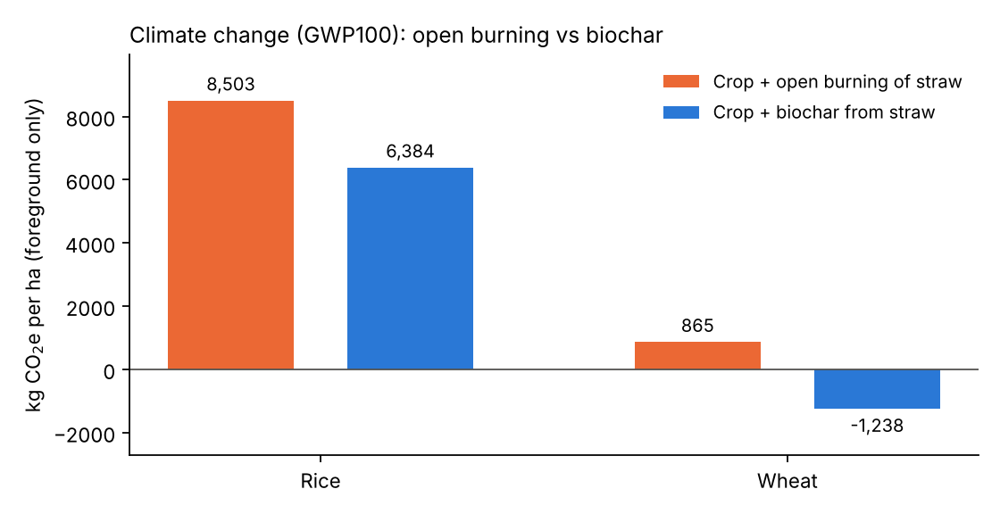

# Crop residue management: open burning vs biochar (rice & wheat, Pakistan)

Life cycle assessment of rice and wheat production per hectare, comparing two straw management routes:

1. **Open burning** of straw in the field
2. **Biochar**: pyrolysis of straw, then soil application with a 100-year carbon-storage credit

The original model was built in openLCA (ecoinvent 3.1 background). This repo re-implements the foreground climate-change calculation in Python so it is reproducible and inspectable, and includes a script to run the full LCIA against openLCA.



## Result (foreground GWP100, kg CO2e per ha)

| Crop | Crop + open burning | Crop + biochar |
|---|---|---|
| Rice | 8,503 | 6,384 |
| Wheat | 865 | -1,238 |

Characterisation: IPCC AR6 GWP100 (CH4 = 27, N2O = 273); biogenic CO2 = 0; soil carbon storage entered as a negative flow.

## Scope and limitations (please read)

- **Foreground only.** Production of fertiliser, diesel, seed, pesticide etc. (ecoinvent background) is *not* included here. Use `scripts/run_openlca.py` for the full result.
- **Possible double counting of the biochar credit.** The rice and wheat crop inventories already contain a soil-carbon credit from biochar applied to the crop (-335 kg for rice, -3,387 kg for wheat), and the biochar scenario adds a second credit for biochar made from the straw. Review before quoting the headline difference.
- **Data under review.** Biochar yield (17%), carbon content (40.3%), permanence (0.758) and harvest indices are literature values pending supervisor confirmation (see the workbook's PARAMETERS sheet). Straw masses in the burning/pyrolysis sheets (about 9,600 kg/ha for rice) predate the corrected straw output in the crop sheet (about 11,159 kg/ha) and were not recomputed.
- N2O is only included where the inventory has it (rice crop); the wheat crop inventory has none.
- Rice data come from the RICE_inventory workbook; wheat crop and open-burning data come from the openLCA export.

## Run

```bash
pip install -r requirements.txt
python scripts/run_analysis.py     # writes results/*.csv and the chart
pytest
```

Full LCIA (needs local openLCA + licensed database): `python scripts/run_openlca.py "<impact method name>"`.

## Data and licensing

`data/foreground_inventories.yaml` contains only the author's own foreground inventories. The ecoinvent database and LCIA method files are licensed and are deliberately excluded (see `.gitignore`).

## Layout

```
data/       foreground inventories (YAML)
src/        model: GWP characterisation + scenarios
scripts/    run_analysis.py (Python model), run_openlca.py (full LCIA via IPC)
results/    CSV tables and chart
tests/
```
